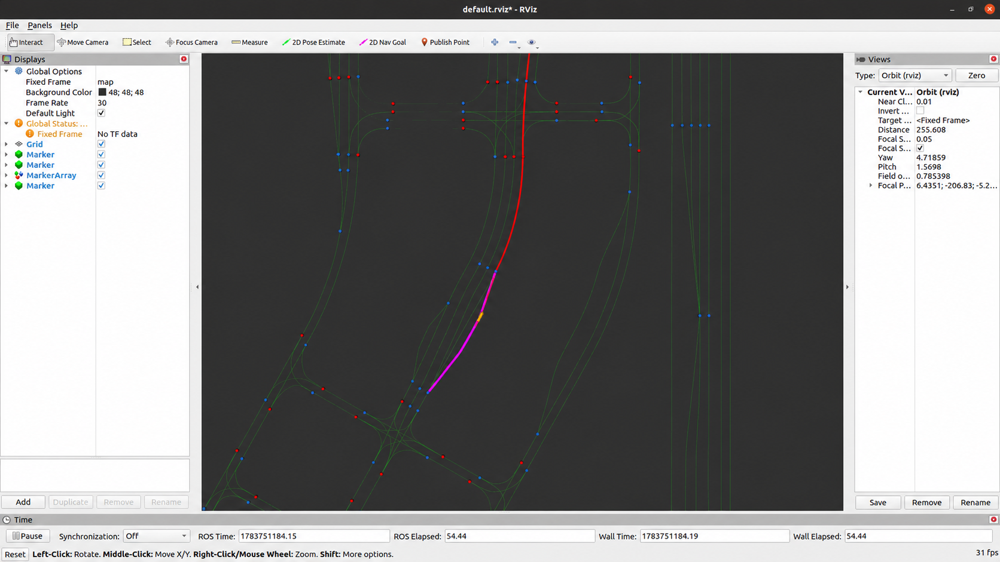
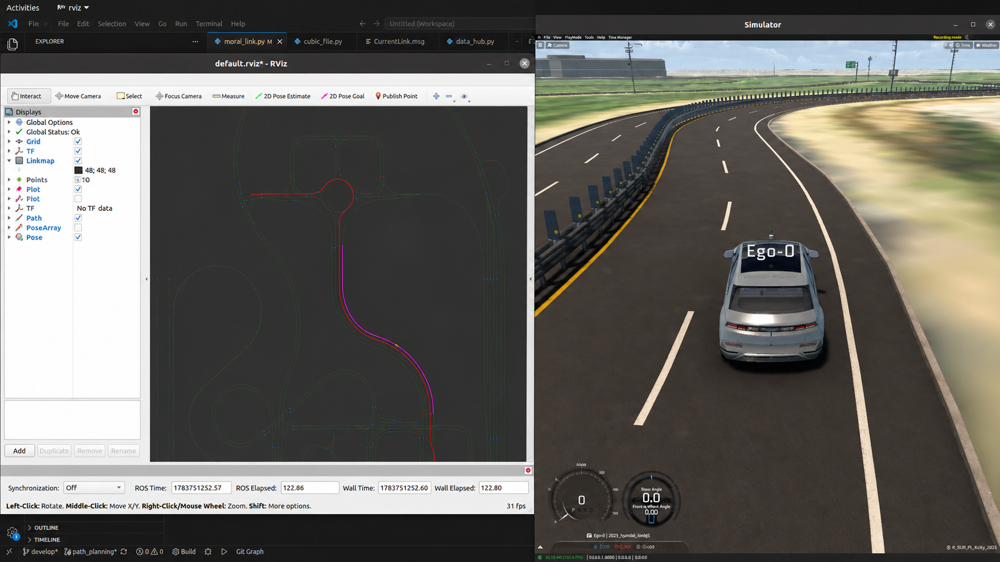
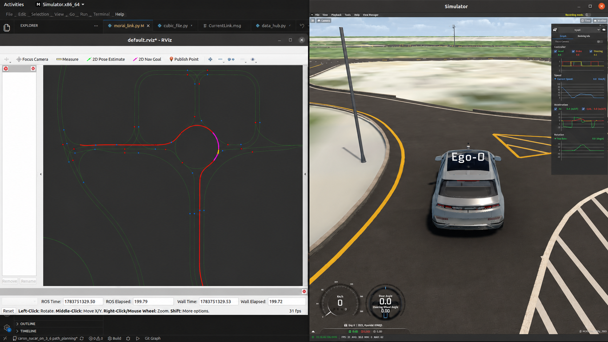

# morai_link

MORAI MGeo 정밀도로지도의 link/node 데이터를 실제 자율주행 판단에 사용할 수 있도록 가공한 **MACARON 8 링크 기반 주행 정보 생성**입니다.

이 저장소는 `macaron_8/src/path_planning/link`에서 구현한 링크 데이터 처리 코드와 그 결과를 정리한 프로젝트 기록입니다. MACARON 8 시스템에서 구성한 링크 기반 기능, 관련 메시지 구조, 사용한 MGeo 데이터를 담았습니다.

## 프로젝트 목표

정밀도로지도의 도로 중심선과 연결 관계를 활용해 차량의 현재 차로, 차선변경 가능한 방향, 전방 도로 상황을 차량 위치 기준으로 계산했습니다.

이 프로젝트에서는 MGeo link/node와 차량의 UTM 위치·yaw를 결합해 다음 정보를 만들었습니다.

- 현재 차량이 주행 중인 link와 제한속도·정지선·신호 정보
- 현재 차로 유지 및 좌·우 차선변경 후보 경로
- 차선변경 이후 추종할 목적 link 중심선
- 교차로, 회전교차로, 고속도로, 톨게이트 등 구간 label
- 링크를 따라 차량 뒤쪽에 생성한 후진 기준점
- 링크 중심선으로 구성한 가상 차선 경계
- 동적 객체가 속한 link와 중심선 기준 상대 위치

## 주요 구현 내용

| 구현 항목 | 구현 결과 |
| --- | --- |
| MGeo 정규화 | link/node를 UTM·RViz 좌표로 변환하고 그래프 및 선분 검색 index 구성 |
| 현재 link 추정 | 거리, 차량 yaw, route, 연결 link, 좌우 차로 관계를 함께 사용 |
| link 전환 안정화 | 새로운 link가 기본 10회 연속 관측될 때 전환 |
| 주행 후보 생성 | center/left/right 최대 3개 후보와 약 40m Bezier 차선변경 곡선 생성 |
| 도로 문맥 생성 | 정지선·신호·교차로·차로·톨게이트·가드레일 label 생성 |
| 구간별 preview | 지정 link의 종점 전 20~25m에서 신호 유형 활성화 |
| 후진 기준점 | 이전 link를 역추적해 기본 8m 후방 위치와 yaw 생성 |
| 가상 중앙선 | link 중심선을 왼쪽으로 1.15m offset한 연속 경계 생성 |
| 동적 객체 link 투영 | link ID, 투영점, 횡거리, 방향 차이로 도로 기준 객체 정보 생성 |

## 전체 데이터 흐름

```text
MGeo link/node ──> 지도 정규화 · link graph · 선분 검색 index
                                      │
차량 UTM pose/yaw ──> 현재 link 추정 ─┼─> CurrentLink 도로 상태
                         │            ├─> center/left/right 후보 경로
                         │            ├─> 차선변경 목적 link 중심선
                         │            ├─> 8m 후방 기준점
                         │            └─> 가상 중앙선
                         │
YOLO-LiDAR 동적 객체 ────┴──────────────> 객체의 link 소속·상대 위치
                                      │
                                      ▼
                 spline 보간 · 점유격자 · 경로 선택 · 차량 제어
```

`morai_link`는 지도 기반 후보와 도로 문맥을 생성하고, MACARON 8의 planning 모듈이 이를 점유격자 및 주행 상태와 결합해 최종 경로를 결정합니다.

## MGeo 데이터 가공

[morai_link_planner.py](path_planning/link/morai_link_planner.py)는 [link_set.json](path/MGeo/link_set.json)과 [node_set.json](path/MGeo/node_set.json)을 읽어 모든 링크 계산의 기준을 만듭니다.

### 좌표계 통합

MGeo의 로컬 좌표에 지도 원점을 더해 차량 localization과 같은 UTM 좌표로 변환했습니다.

```text
origin_utm_x = 302595.0
origin_utm_y = 4124145.0

utm_x = morai_x + origin_utm_x
utm_y = morai_y + origin_utm_y
```

각 지도 점에는 원본 MORAI 좌표, UTM 좌표, RViz/곡선 계산 좌표를 함께 보관합니다.

### 지도 index

634개 link, 480개 node, 74,782개 선분을 다음 구조로 변환했습니다.

- link ID → link 데이터
- 시작/종료 node → 연결 link 목록
- link → 좌우 차선변경 인접 link
- 전체 선분의 시작점·방향벡터·길이·heading NumPy 배열
- link ID → 최근접 검색용 선분 index

차량 위치가 갱신될 때 전체 JSON을 반복 순회하지 않고, 벡터화된 선분 투영과 제한된 후보 집합을 이용해 현재 link를 찾습니다.

### 원본 지도 보정

주행 구간에 맞게 MGeo 속성을 코드의 override로 정의했습니다.

- 구간별 좌·우 차선변경 허용 여부 설정
- `A2256W000319 ↔ A2256W000318` 차선변경 목적 link 연결
- `A2256W000849 ↔ A2256W000054` 차선변경 목적 link 연결
- `A2256W000054`의 도로 type 보정
- `A2256W000182`의 비보호 좌회전 신호 속성 보정

## route와 현재 link 추정

[morai_link.py](path_planning/link/morai_link.py)의 route는 40개 항목, 39개 고유 link, 약 2.185km로 구성된 순환 경로입니다. 시작과 끝은 `A2256W000748`로 같습니다.

실제 주행 중 route 옆 차로로 이동할 수 있으므로 route link만 검색하지 않았습니다. 각 route link에서 최대 세 번의 좌우 차선 이동으로 도달할 수 있는 link까지 확장해 55개 link, 7,560개 선분을 현재 위치 검색 범위로 구성했습니다.

현재 link 탐색은 다음 순서로 이루어집니다.

1. 첫 위치에서는 55개 whitelist 전체에서 최근접 선분 검색
2. 이후에는 현재 link, 연결 link, 다음 link와 좌우 차로를 우선 검색
3. 차량 점을 각 선분에 직교 투영해 최단거리 계산
4. yaw가 있으면 차량과 link의 진행 방향 차이가 90° 이내인 선분 우선
5. 지역 탐색 결과가 4m보다 멀면 전체 whitelist에서 재탐색
6. 다른 link가 선택되면 기본 10회 연속 확인 후 현재 link 변경

연속 관측 확인으로 현재 link의 전환 시점을 관리하고, 확인 중에는 기존 link 기준의 진행도와 후보 경로를 유지합니다.

## 현재 도로 상태 생성

현재 link와 종료 node의 정보를 합쳐 `CurrentLink` 메시지를 구성했습니다.

| 필드 | 생성 기준 | MACARON 8에서 연결되는 판단 |
| --- | --- | --- |
| `link_idx` | 최근접 link ID | 현재 차로 및 mission 구간 식별 |
| `link_type` | MGeo type, 교차로 진입 전 preview 포함 | 일반도로·교차로 구분 |
| `max_speed` | link 제한속도 | 도로 속도 정보 |
| `on_stop_line` | 종료 node의 정지선 속성 | 정지선 상태 |
| `traffic_light_id` | 종료 node의 신호등 ID | 지도 신호등과 perception 연결 |
| `related_signal` | 직진·좌회전 등 link 진행 신호 | 진행 방향별 신호 판단 |
| `can_change_left/right` | 해당 방향 후보가 실제 생성됐는지 | 차선변경 가능한 방향 판단 |
| `intersection_type` | link별로 정의한 주행 구간 label | 신호등 형태 및 mission 상태 전환 |

`can_change_left/right`는 지도 flag를 그대로 전달하지 않고, 현재 위치에서 필요한 길이의 후보 곡선을 실제로 만들 수 있을 때만 참으로 설정했습니다.

다음 link는 종점까지의 잔여 거리를 계산해 구간별로 지정한 위치에서 신호 유형을 활성화했습니다.

| Link ID | `intersection_type` 활성 범위 |
| --- | ---: |
| `A2256W000213` | 종점 전 25m |
| `A2256W000308` | 종점 전 20m |
| `A2256W000315` | 종점 전 20m |

## 주행 후보 경로

[lane_change_candidate.py](path_planning/link/lane_change_candidate.py)는 차량의 현재 link 진행도에서 최대 세 종류의 후보를 만듭니다.

| Candidate ID | 종류 | 생성 방식 |
| ---: | --- | --- |
| 0 | center | 현재 위치부터 link 중심선을 전방으로 연결 |
| 1 | left | 왼쪽 목적 link의 진행 방향과 3차 Bezier로 연결 |
| 2 | right | 오른쪽 목적 link의 진행 방향과 3차 Bezier로 연결 |

후보 경로는 기본 40m이며, 목적 link가 짧으면 다음 연결 link까지 확장합니다. 구간에서 확보되는 거리에 따라 최소 16m까지 후보 길이를 조정하고, 곡선 길이는 최대 12회의 이분 탐색으로 목표 대비 0.15m 이내가 되도록 맞췄습니다. Bezier 점은 약 0.5m 간격으로 생성합니다.

같은 link에서 차량 진행도가 1m 미만으로 변한 경우 이전 결과를 재사용해 불필요한 곡선 재계산과 latched topic 갱신을 줄였습니다.

차선변경 후보와 별도로 목적 link의 원본 중심선도 link 순서와 함께 생성했습니다. 이 데이터는 차선변경이 시작된 뒤 목적 차로를 유지하거나, 일반 후보보다 link 기반 추종이 적합한 구간에서 사용됩니다.

## 후방 기준점과 가상 경계

[reverse_link.py](path_planning/link/reverse_link.py)는 현재 link의 점을 역방향으로 누적하고, 목표 거리에 따라 이전 link까지 연결해 기본 8m 뒤의 위치와 진행 yaw를 계산합니다. 분기점에서는 실제 관측한 이전 link, route의 이전 link, heading 연결 순으로 자연스러운 후방 경로를 선택했습니다.

[virtual_lane_boundary.py](path_planning/link/virtual_lane_boundary.py)는 지정 구간의 link 접선에서 왼쪽 법선을 구하고 중심선을 1.15m 이동시켜 가상의 좌측 중앙선을 만듭니다.

```text
가상 좌측 경계  ─────────────────────
                  1.15m
link 중심선      ─────────────────────>
```

적용 구간은 `A2256W000304 → A2256W000148`과 `A2256W000213`이며, 연속 link의 중복 접속점은 제거해 하나의 경계로 연결했습니다.

## 동적 객체의 link 투영

[dynamic_obstacle_link_projector.py](path_planning/link/dynamic_obstacle_link_projector.py)는 YOLO-LiDAR fusion 객체를 차량이 진행 가능한 link에 투영합니다.

- 이동 상태가 `MOVING`인 객체
- 진행 방향이 유효한 객체
- 자차에서 50m 이내인 객체
- 선택된 link와 heading 오차가 45° 이내인 객체

위 조건을 적용한 뒤 다음 도로 기준 정보를 생성했습니다.

| 결과 | 의미 |
| --- | --- |
| `nearest_link_idx` | 객체가 속한 것으로 판단한 link |
| `projected_position_utm` | link 중심선 위 투영점 |
| `ego_distance_m` | 자차와 객체 사이 평면거리 |
| `signed_link_distance_m` | link 중심선 기준 횡거리, 왼쪽 양수·오른쪽 음수 |
| `signed_heading_error_rad` | link와 객체 진행 방향 차이 |

이를 통해 객체의 절대좌표를 “어느 차로의 어느 쪽에서 어떤 방향으로 움직이는가”라는 link 기준 정보로 바꿨습니다.

## 생성 데이터와 시스템 연결

| 생성 데이터 | 내용 | 연결 모듈 |
| --- | --- | --- |
| `/morai_map_data` | 정규화된 전체 link/node | RViz 지도 시각화 |
| `/current_link_data` | 현재 link와 도로 문맥 | tracking, highway, traffic, rear vision |
| `/lane_change_candidate_data` | center/left/right 기하 경로 | `cubic_spline.cpp`의 경로 보간 |
| `/lane_change_candidate_link` | 좌·우 목적 link 중심선 | 차선변경 이후 목적 차로 추종 |
| `/reverse_link_point` | link 기준 후방 위치와 yaw | 후진·주차 경로계획 |
| `/current_link_virtual_lane_boundaries` | 가상 좌측 중앙선 | 점유격자 기반 경로 제약 |
| `/dynamic_obstacle_link_data` | 동적 객체의 link 소속과 상대 위치 | 객체-차로 관계 표현 |

MACARON 8에서는 후보 경로를 spline으로 보간한 뒤 `tracking_planner_occupancy.py`가 점유격자, 장애물, 차선변경 가능 방향, 구간 상태, 후방 차량 정보와 함께 평가합니다. `highway_planner.py`는 `LANE_1/2/3` label을 의무 차선변경 판단에 사용하고, `traffic.py`는 신호등 유형을, 후방 인지 모듈은 좌우 차선변경 가능 여부를 사용합니다.

## 모듈 관계

```text
path_planning/link/
├── morai_link.py
│   └── ROS 데이터 흐름, 현재 link 상태, 하위 계산 모듈 조합
├── morai_link_planner.py
│   └── MGeo 로드, 좌표 변환, graph/index, 최근접 선분 검색
├── lane_change_candidate.py
│   └── center/left/right 후보와 목적 link chain 생성
├── reverse_link.py
│   └── 이전 link 선택과 후방 목표점 계산
├── virtual_lane_boundary.py
│   └── 중심선 offset 기반 가상 경계 생성
└── dynamic_obstacle_link_projector.py
    └── 동적 객체를 주행 가능한 link에 투영
```

세부 함수 흐름과 설계 판단은 [Architecture](docs/ARCHITECTURE.md), 지도 데이터와 생성 결과는 [구현 결과](docs/RESULTS.md)에 정리했습니다.

## 결과 시각화

MGeo 도로망과 생성 경로를 RViz에 표시하고 MORAI 차량 위치와 비교했습니다.







## 저장소 범위

이 저장소에는 링크 처리 코드, MGeo link/node 데이터, 관련 ROS 메시지 정의와 시각화 결과를 담았습니다. 링크 데이터로 만든 주행 정보와 MACARON 8 시스템에 연결한 과정을 소개합니다.
