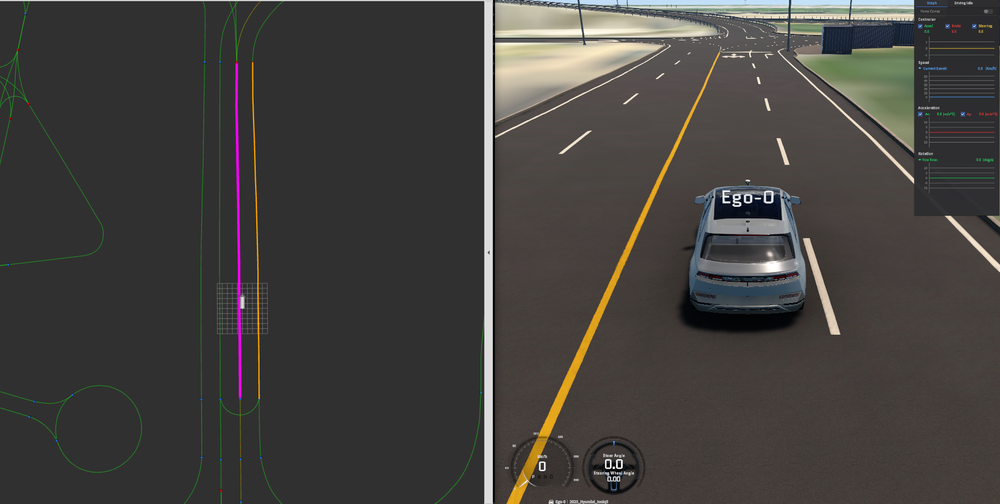
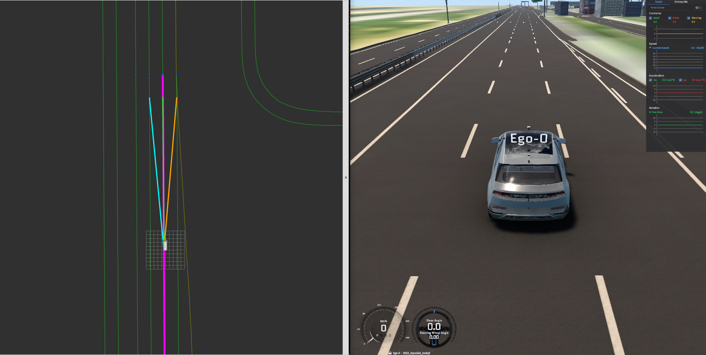
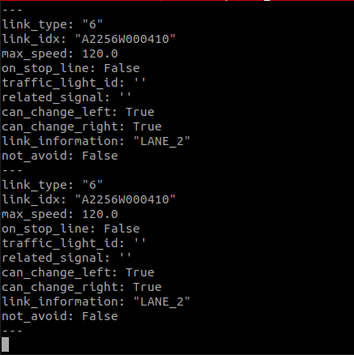

# MORAI_LINK

MACARON_8에서 MORAI 주행을 위해 구현한 링크 기반 지도 처리와 경로 생성 코드입니다. 차량의 위치·방향과 MGeo 도로망을 결합해 현재 차로를 판단하고, 주행 후보 경로와 도로 구간 정보를 생성했습니다.

평행 차로에서의 링크 오인식, 교차로와 분기점의 연결 관계, 지도 속성의 불일치, 터널 차선 변경 이후의 후진 상황을 처리하는 로직을 파일별로 정리했습니다.

## 1. 현재 링크 추정과 주행 정보 — [morai_link.py](link/morai_link.py)

ROS 입출력과 현재 링크 상태를 관리하고, 지도 검색·후보 경로·후방 목표·가상 경계 계산을 연결했습니다.

- **검색 범위와 재탐색**: 기준 경로에서 허용된 차선 변경을 최대 3회 거쳐 도달하는 차로까지 검색 범위를 확장했습니다. 현재 링크와 연결·인접 차로를 우선 검색하고, 결과가 없거나 투영 거리가 4m를 넘거나 방향 필터를 만족하는 선분이 없으면 전체 허용 범위를 다시 검색합니다.
- **링크 전환 안정화**: 최초 링크는 즉시 인식하되, 이후에는 같은 새 링크가 10회 연속 관측될 때만 전환합니다. 확정 전에는 차량을 기존 링크에 다시 투영해 현재 링크와 후보 경로의 기준이 순간적으로 옆 차로로 바뀌는 것을 억제했습니다.
- **거리 기반 도로 정보**: 현재 `link_type`이 `6`이고 다음 링크가 교차로(`1`)이면, 중심선을 따라 종점까지 남은 거리가 15m 이내일 때 교차로 속성을 미리 전달합니다. 지정된 신호 형태 정보와 회피 제한 정보도 링크 전체 또는 종점까지의 잔여거리에 따라 적용했습니다.
- **여러 링크에 걸친 구간 처리**: 미리 지정한 연속 도로 구간에 공통 속성인 `link_type=17`을 적용했습니다. 첫 링크의 종점 부근부터 마지막 링크의 초반까지 적용 범위를 정의하고, 시작·끝 경계점을 인접 차로 중심선에 투영해 차로별 길이 차이를 반영한 진행거리 범위를 구성했습니다.
- **차선 변경 조건의 일관성**: 특정 구간·방향에 설정한 최소 진행거리 조건을 현재 링크 검색의 목적 차로 제외, 후보 경로 필터링, 차선 변경 허용 정보에 함께 적용했습니다.
- **후보와 목적 차로의 동기화**: 후보 경로는 12Hz 타이머에서 재계산하고, 목적 차로 중심선은 확정된 현재 링크를 기준으로 선택합니다. 목적 링크 구성이 같으면 기존 발행값을 유지하고, 변경 불가나 링크 검색 실패 시 빈 데이터로 지웁니다.

왼쪽 RViz의 차량 위치와 주변 링크를 오른쪽 MORAI의 차로 배치와 나란히 비교한 장면입니다.

## 2. 지도 정규화와 선분 검색 — [morai_link_planner.py](link/morai_link_planner.py)

[링크 지도](path/link_set.json)와 [노드 지도](path/node_set.json)를 로딩하며 MORAI 로컬 좌표를 UTM 좌표로 변환하고, 링크·노드·인접 차로의 연결 관계를 구성했습니다. 선분의 시작점, 방향벡터, 길이, 진행 방향을 NumPy 배열로 저장해 차량 위치를 후보 선분에 일괄 투영합니다. 투영 비율을 선분 내부로 제한하고, 차량과의 방향 오차가 허용 범위(기본 90°)인 선분 중 최단 거리의 링크를 선택합니다.

- **지도 속성 보정**: 차선 변경 금지 방향, 잘못된 목적 링크, 링크 종류와 진행 신호를 로딩 단계에서 보정했습니다. 현재 링크 판단과 후보 생성이 같은 지도 속성을 참조하도록 했습니다.
- **터널 링크 방향 보정**: 실제 진행 방향과 반대로 정의된 터널 링크의 점 순서와 시작·종료 노드를 뒤집었습니다. 시작·끝 폭, 좌우 차선 표시, 차선 변경 허용 여부와 목적 링크도 함께 교환하고, 인접 차로의 목적 링크 참조까지 보정해 방향과 연결 정보가 일치하도록 했습니다.
- **유효하지 않은 기하 제외**: 형식이 잘못된 점, 점이 두 개 미만인 링크, 길이가 0인 선분은 해당 기하 계산에서 제외합니다. 방향 조건을 만족하는 선분이 없으면 거리 기준 결과를 반환해 상위 모듈에서 재탐색하도록 했습니다.

회전교차로와 진입·진출 도로의 링크 연결 구조를 MORAI 도로 형상과 함께 확인한 장면입니다.

## 3. 차로 유지·변경 후보 생성 — [lane_change_candidate.py](link/lane_change_candidate.py)

현재 링크 중심선을 따라가는 `center`와 인접 차로로 이동하는 `left/right` 후보를 생성했습니다. 중앙 후보는 전체 주행 경로에서 만들고, 좌우 후보는 고속도로 구간과 그 인접 차로로 제한했습니다.

차선 변경 목표점은 시작점을 중심으로 한 원과 목적 차로 중심선의 첫 전방 교점을 해석적으로 구합니다. 시작점과 목표점을 직선으로 연결한 뒤 목적 차로 중심선을 따라 연장해 차선 변경 이후의 경로까지 포함했습니다.

- **후보 길이 구성**: 중앙 후보는 기본 40m를 목표로 하며, 고속도로 허용 구간에서는 최대 80m까지 중심선을 따라 수집합니다. 좌우 후보는 기본 40m 직선 뒤에 목적 차로 중심선을 최대 40m 연장합니다.
- **구간별 종점 제한**: 설정된 일부 구간에 한해 변경 직선의 목표 길이를 20m로 줄이거나, 직선의 종점이 직접 인접한 목적 링크를 벗어나는 후보를 제외했습니다. 종점 제한 구간에서는 후보를 임의로 잘라 대체하지 않고, 이후 중심선 연장도 해당 목적 링크 안으로 제한했습니다.
- **짧은 목적 경로 처리**: 목표 반경의 교점을 확보하지 못하면 목적 중심선 끝점을 대체 목표로 검사합니다. 시작점과의 직선거리가 최소 기준 16m부터 목표 길이까지의 범위에 들 때만 축소 후보를 허용하며, 길이 판정에는 0.15m의 허용 오차를 적용했습니다.
- **분기·순환 처리**: 연결 링크는 기준 경로를 우선하며, 선택 근거가 없는 다중 분기에서는 확장을 중단합니다. 방문 링크와 탐색 횟수로 순환을 차단하고, 연결부의 중복 점과 길이가 0인 선분을 처리했습니다.

차량 위치에서 전방과 좌우 차로로 이어지는 후보 경로를 MORAI의 차로 배치와 함께 표시한 장면입니다. [RViz 후보 경로 확대 보기](docs/images/rviz-lane-change-candidates.png)에서 연결 형태를 자세히 확인할 수 있습니다.

## 4. 링크 역추적과 후방 목표 — [reverse_link.py](link/reverse_link.py)

현재 위치에 가장 가까운 지도 점을 기준으로 링크를 역순으로 따라가며 거리를 누적하고, 기본 목표 거리 8m에 도달한 지도 점을 후방 목표로 선택했습니다. 현재 링크 안에서 거리가 부족하면 이전 링크까지 이어서 탐색하고, 목표점 이후의 유효한 전방 점으로 링크 진행 방향을 계산합니다.

- **이전 링크 선택**: 명시한 보정 관계를 먼저 적용하고, 일반적인 연결에서는 실제 관측한 직전 링크, 기준 경로의 이전 링크, 유일한 연결 후보, 진행 방향이 가장 자연스러운 링크 순으로 선택합니다.
- **끊어진 연결 보완**: 지도상 노드가 분리된 구간에는 별도의 이전 링크 연결 관계를 정의했습니다. 일반 노드 연결보다 이 보정 관계를 우선 적용해 후방 탐색이 이전 도로 구간으로 이어지도록 했습니다.
- **탐색·방향 예외처리**: 방문 링크와 최대 탐색 깊이로 순환을 제한합니다. 같은 좌표가 연속되면 다음 유효 점을 찾아 목표 방향을 계산했습니다.

## 5. 터널 후진 차로 선택 — [tunnel_reverse.py](link/tunnel_reverse.py)

터널 차로와 링크의 대응 관계를 정의하고, 차선 변경 전후의 차로와 변경 시점의 진행거리 `s`를 기록하는 `TunnelReversePolicy`를 ROS와 독립적인 정책 클래스로 구현했습니다.

- **변경 직후 충돌 처리**: 현재 차로가 최근 차선 변경의 도착 차로이고, 충돌 시점의 `s`가 변경 위치의 ±6m 이내이면 변경 전 차로를 후진 목표 차로로 선택합니다. 그 밖의 경우에는 현재 차로를 유지합니다.
- **후진 중 이력 보호**: 후진으로 발생한 차로 전환은 새로운 차선 변경 이력으로 덮어쓰지 않습니다.
- **터널 재진입 처리**: 터널을 벗어나면 최근 변경 정보를 초기화해 이전 통과 이력이 다음 진입의 차로 선택에 영향을 주지 않도록 했습니다.

## 6. 가상 차선 경계 — [virtual_lane_boundary.py](link/virtual_lane_boundary.py)

중심선의 접선에 수직인 법선벡터를 구하고, 차로 폭 3.5m의 절반인 1.75m만큼 이동시켜 가상 경계를 생성했습니다. 내부 점은 앞뒤 점을 함께 사용해 접선을 계산합니다.

- **구간별 경계 구성**: 필요한 도로 구간을 링크 묶음으로 지정하고, 각 링크의 진행 방향을 기준으로 왼쪽 또는 오른쪽 경계를 생성했습니다. 좌우 구분은 `boundary_id`에 각각 `0`, `1`로 담아 함께 발행합니다.
- **접선 계산 보완**: 접선 길이가 0이면 인접한 유효 선분으로 대체하고, 이웃 선분도 사용할 수 없으면 기준 방향 `(1, 0)`을 사용합니다. 전체 길이가 0인 링크는 경계를 생성하지 않습니다.
- **연결부 중복 제거**: 설정된 링크 순서로 경계를 모으되, 이어지는 경계의 `boundary_id`가 같고 접속점이 1mm 이내이면 중복 접점을 제거했습니다.

## 7. 도로 상태 표현 — [CurrentLink.msg](msg/CurrentLink.msg)

확정된 링크 ID와 종류, 제한속도, 정지선·신호, 좌우 차선 변경 허용 여부를 하나의 메시지에 묶었습니다. 정지선 여부와 신호등 ID는 현재 링크의 종료 노드에서 가져오고, `related_signal`은 보정된 링크 속성을 사용합니다.

`can_change_left/right`는 지도 보정 속성과 현재 진행거리 제한으로 결정하며, 후보 경로 생성의 성공 여부와 독립적으로 발행합니다. `link_information`에는 신호 형태·회전교차로·고속도로·톨게이트 등의 구간 정보를, `not_avoid`에는 회피를 제한해야 하는 구간 여부를 담았습니다.

`link_type`, `max_speed`, `can_change_left/right`, `link_information` 등 도로 상태 필드의 출력 예시입니다.
